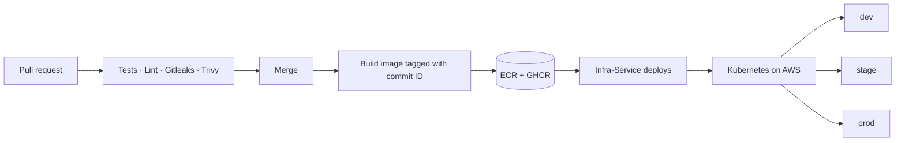

  

<h3 align="center">Find your preferred property in 3 clicks, not months.</h3>

Exact locations. Real developers. Verified agents.

---

## What this is

Expert Listing is a property platform: browse listings, and find verified professionals near you. This organisation holds the application services **and** the infrastructure that ships them, kept in separate repositories on purpose. Apps build and prove their own images; one infrastructure repo decides where those images run.

## Repositories

| Repository | What it does |
|---|---|
| [Expert-Listing-Frontend-Service](https://github.com/Experts-Listing/Expert-Listing-Frontend-Service) | The web app, built with React and Vite, served by nginx |
| [Expert-Listing-Backend-Server-Service](https://github.com/Experts-Listing/Expert-Listing-Backend-Server-Service) | Express API for expert listings and search |
| [Expert-Listing-Geo-Bucket](https://github.com/Experts-Listing/Expert-Listing-Geo-Bucket) | Groups coordinates into grid buckets, so nearby lookups stay fast |
| [Infra-Service](https://github.com/Experts-Listing/Infra-Service) | Terraform, Helm charts and the deployment pipeline |

## How we ship

- **Every commit becomes one image**, tagged with its commit ID. The same image moves from dev to stage to prod, so what we tested is exactly what goes live.
- **Every pull request is checked:** unit tests, lint, secret scanning (Gitleaks) and vulnerability scanning (Trivy). Serious findings stop the build.
- **Deploys run from Infra-Service**, not from the app repos. Helm applies the change, the pipeline confirms the app is healthy, and a deploy that doesn't come up is rolled back automatically.
- **Production waits for a human approval,** and every deploy is posted to Slack.

## Environments

| Environment | Purpose | Service copies |
|---|---|---|
| `dev` | Deploys automatically on merge | 1–2 |
| `stage` | Pre-production checks | 2–4 |
| `prod` | Live, approval required | 3–8 |

Each service scales on its own based on CPU and memory.

## Stack

Node.js · React · Docker · GitHub Actions · Terraform · AWS (EKS, ECR, ALB, CloudWatch) · Helm · Slack alerts
